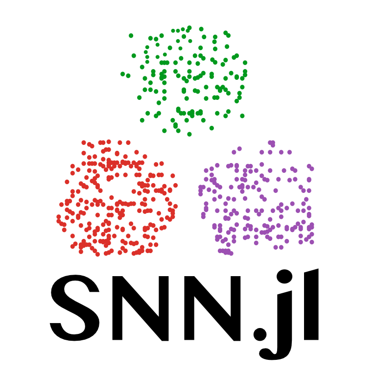

    

# SpikingNeuralNetworks.jl

Simulate networks of spiking neurons in Julia. Install with `] add SpikingNeuralNetworks` and start
with [Getting started](https://juliasnn.github.io/SpikingNeuralNetworks.jl/dev/getting_started/).

Upgrading from version 1: see
[What changes from v1 to v2](https://juliasnn.github.io/SpikingNeuralNetworks.jl/dev/#What-changes-from-v1-to-v2).
