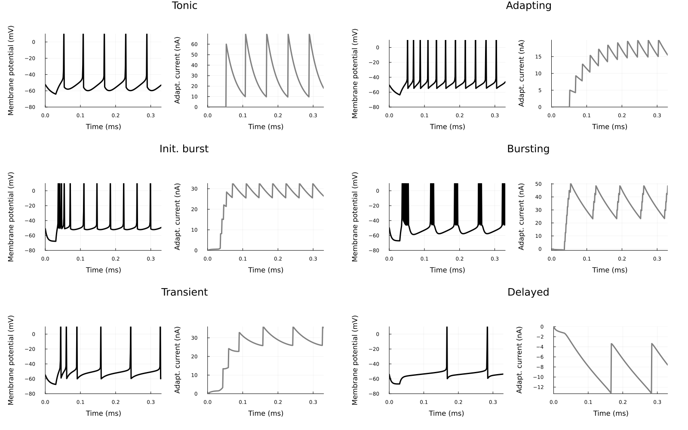
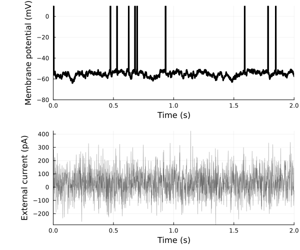
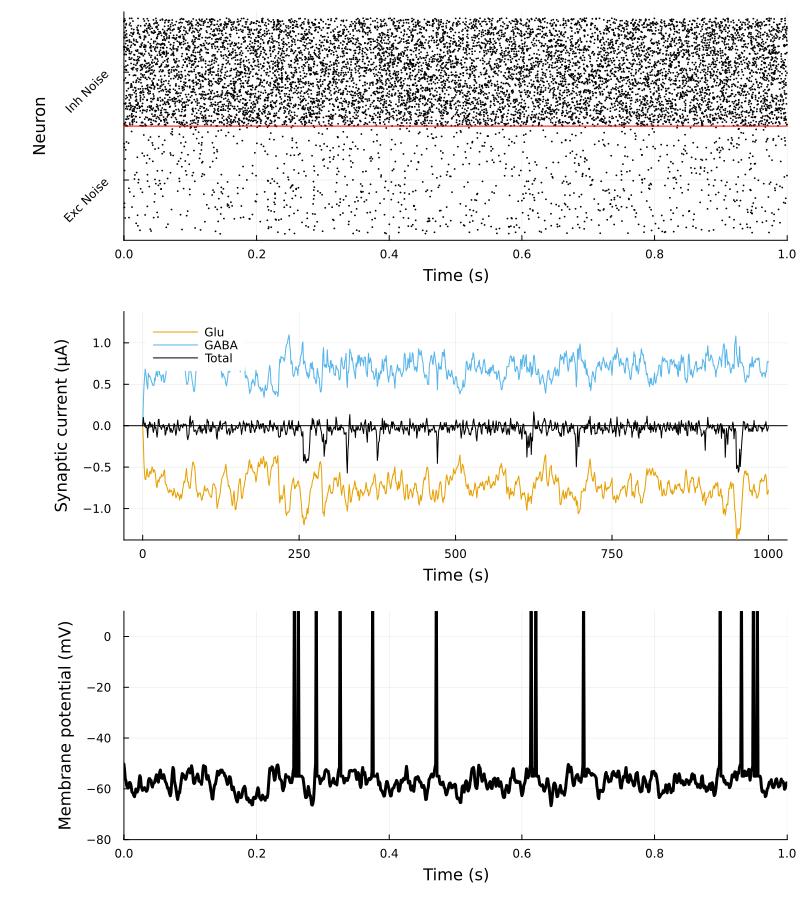
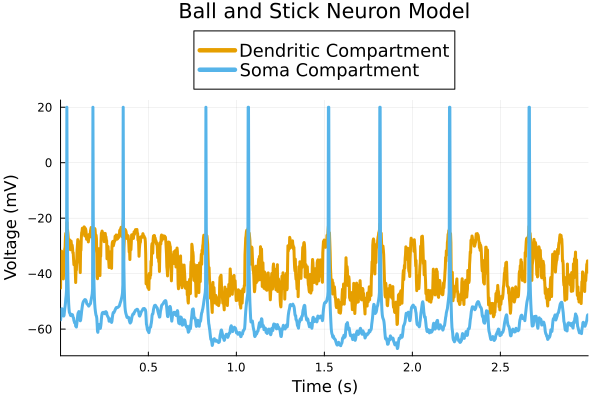
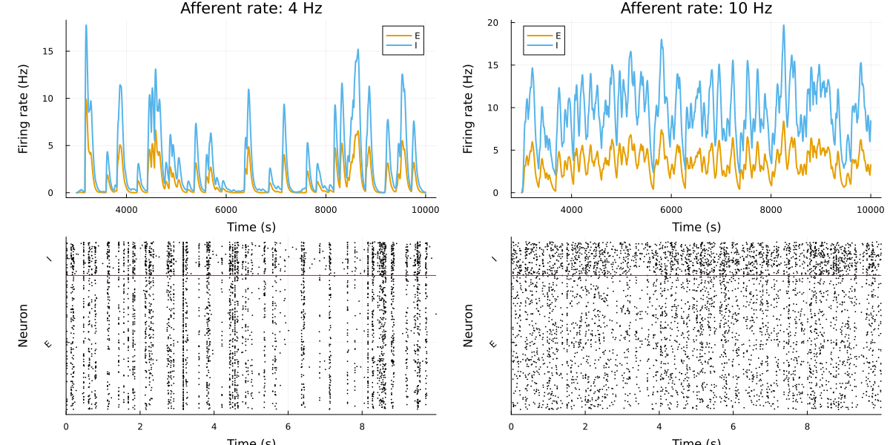
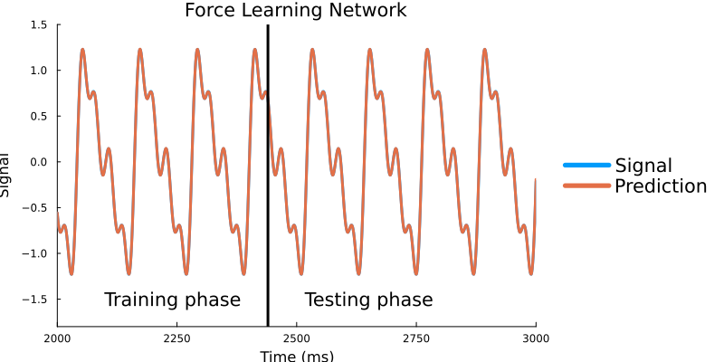

# Examples

Self-contained scripts, each runnable in a session with `SpikingNeuralNetworks` and `CairoMakie`
installed. Longer scripts are in the
[examples](https://github.com/JuliaSNN/SpikingNeuralNetworks.jl/tree/main/examples) folder of the
package.

## AdEx neuron

The adaptive exponential integrate-and-fire (AdEx) model ([Brette and Gerstner, 2005](https://pubmed.ncbi.nlm.nih.gov/16014787/))
reproduces several firing patterns observed under direct current injection
([AdEx firing patterns](https://neuronaldynamics.epfl.ch/online/Ch6.S2.html)). The model has a
membrane potential ``V`` and an adaptation current ``w``:

```math
\begin{align}
    \tau_m \frac{dV}{dt} &= -(V - E_l) + \Delta_T \exp\left(\frac{V - \theta}{\Delta_T}\right) + R\,(I - w - I_{syn}) \\
    \tau_w \frac{dw}{dt} &= a (V - E_l) - w
\end{align}
```

The threshold ``\theta`` relaxes to ``V_t`` with time constant ``\tau_A`` and is increased by
``A_t`` after each spike (both from `PostSpike`; with the default `At = 0` it stays at ``V_t``).
A spike is emitted when ``V \geq 0`` mV: ``V`` is reset to ``V_r`` and held during the refractory
period `τabs`; ``w`` is incremented by ``b`` (see [Integrate-and-fire neurons](catalogue/neurons_if.md)).

Changing the membrane time constant, the reset potential and the adaptation parameters gives
different firing patterns:

```julia
using SpikingNeuralNetworks
SNN.@load_units
using CairoMakie

# (pattern, τm (ms), a (nS), τw (ms), b (pA), Vr (mV), I (pA))
patterns = [
    ("Tonic", 20, 0.0, 30.0, 60.0, -55.0, 65),
    ("Adapting", 20, 0.0, 100.0, 5.0, -55.0, 65),
    ("Init. burst", 5.0, 0.5, 100.0, 7.0, -51.0, 65),
    ("Bursting", 5.0, -0.5, 100.0, 7.0, -46.0, 65),
    ("Transient", 10, 1.0, 100, 10.0, -60.0, 65),
    ("Delayed", 5.0, -1.0, 100.0, 10.0, -60.0, 25),
]

fig = Figure(size = (900, 700))
for (n, (name, τm, a, τw, b, Vr, I)) in enumerate(patterns)
    param = SNN.AdExParameter(
        R = 0.5GΩ,
        Vt = -50mV,
        ΔT = 2mV,
        El = -70mV,
        τm = τm * ms,
        Vr = Vr * mV,
        a = a * nS,
        b = b * pA,
        τw = τw * ms,
    )
    E = SNN.AdEx(; N = 1, param)
    SNN.monitor!(E, [:v, :fire, :w], sr = 8kHz)
    model = SNN.compose(; E, silent = true)

    E.I .= 5pA                      # weak current for 30 ms
    SNN.sim!(; model, duration = 30ms)
    E.I .= I * pA                   # current step
    SNN.sim!(; model, duration = 300ms)

    ax = Axis(fig[(n - 1) ÷ 2 + 1, (n - 1) % 2 + 1], title = name, ylabel = "V (mV)")
    SNN.vecplot!(ax, E, :v, add_spikes = true, color = :black)
end
save(joinpath(mktempdir(), "AdEx_neuron_types.png"), fig)
```



## Noise input current

In vivo, neurons are driven by noisy inputs. A simple description splits the input current in a
deterministic and a stochastic component, ``I = I^{det}(t) + I^{noise}(t)``, and the membrane
dynamics of a generalized integrate-and-fire neuron reads

```math
\tau_{m} \frac{d u}{ d t} = f(u) + R I^{det}(t) + R I^{noise}(t)
```

`CurrentNoise` sets the target variable to `I_base` plus a fresh sample of `I_dist` at every
step (see [Stimuli](catalogue/stimuli.md)). Here a leaky integrate-and-fire neuron receives 30 pA
plus Gaussian noise of 100 pA standard deviation on its `:I` variable.

```julia
using SpikingNeuralNetworks
SNN.@load_units
using CairoMakie
using Distributions

if_neuron = (
    param = SNN.IFParameter(R = 0.5GΩ, Vt = -50mV, El = -70mV, τm = 20ms, Vr = -55mV),
    spike = SNN.PostSpike(),
    synapse = SNN.SingleExpSynapse(),
)
E = SNN.Population(; N = 1, if_neuron...)
SNN.monitor!(E, [:v, :fire, :I], sr = 2kHz)

# white-noise input current
current_param = SNN.CurrentNoise(E.N; I_base = 30pA, I_dist = Normal(0pA, 100pA))
current_stim = SNN.Stimulus(current_param, E, :I)
model = SNN.compose(; E, I = current_stim, silent = true)
SNN.sim!(; model, duration = 1000ms)

fig = Figure(size = (600, 500))
ax1 = Axis(fig[1, 1], ylabel = "Membrane potential (mV)")
SNN.vecplot!(ax1, E, :v, add_spikes = true, color = :black)
ax2 = Axis(fig[2, 1], ylabel = "External current (pA)", xlabel = "Time (s)")
SNN.vecplot!(ax2, E, :I, color = :gray, lw = 0.5)
save(joinpath(mktempdir(), "noise_current.png"), fig)
```



## Balanced input spikes

Two layers of Poisson neurons, one excitatory (`:glu`) and one inhibitory (`:gaba`), drive an AdEx
neuron into the high-conductance state, where the synaptic conductance dominates the leak.

```julia
using SpikingNeuralNetworks
SNN.@load_units
using CairoMakie

neuron_parameter = (
    param = SNN.AdExParameter(R = 0.5GΩ, Vt = -50mV, ΔT = 2mV, El = -70mV, τm = 20ms, Vr = -55mV),
    synapse = SNN.DoubleExpSynapse(),
    spike = SNN.PostSpike(τabs = 5ms),
)
E = SNN.Population(; neuron_parameter..., N = 1)

poisson_exc = SNN.PoissonLayer(rate = 1Hz, N = 1000)
poisson_inh = SNN.PoissonLayer(rate = 10Hz, N = 1000)
conn = (p = 1, μ = 5nS)
stim_exc = SNN.Stimulus(poisson_exc, E, :glu; conn, name = "Exc Noise")
stim_inh = SNN.Stimulus(poisson_inh, E, :gaba; conn, name = "Inh Noise")

model = SNN.compose(; E, stim_exc, stim_inh, silent = true)
SNN.monitor!(E, [:v, :fire], sr = 2kHz)
SNN.monitor!(E, [:glu, :gaba], sr = 2kHz, variables = :receptors) # receptor conductances
SNN.monitor!(model.stim, [:fire])
SNN.sim!(; model, duration = 1000ms)

fig = Figure(size = (800, 800))
ax1 = Axis(fig[1, 1], ylabel = "Input neuron")
SNNPlots.raster!(ax1, model.stim)
ax2 = Axis(fig[2, 1], ylabel = "Conductance (nS)")
SNN.vecplot!(ax2, E, :glu, variables = :receptors, label = "glu")
SNN.vecplot!(ax2, E, :gaba, variables = :receptors, label = "gaba")
ax3 = Axis(fig[3, 1], ylabel = "Membrane potential (mV)", xlabel = "Time (s)")
SNN.vecplot!(ax3, E, :v, add_spikes = true, color = :black)
save(joinpath(mktempdir(), "balanced_stimuli.png"), fig)
```



## Ball-and-stick neuron

A passive dendrite with NMDA receptors coupled to an AdEx soma (see
[Multicompartment neurons](catalogue/multicompartment.md)). Inputs target a compartment with the
extra argument `:s` (soma) or `:d` (dendrite).

```julia
using SpikingNeuralNetworks
SNN.@load_units
using CairoMakie

adex = SNN.AdExParameter(C = 281pF, gl = 40nS, Vr = -55.6mV, El = -70.6mV, ΔT = 2mV,
                         Vt = -50.4mV, a = 4nS, b = 80.5pA, τw = 144ms)
E = SNN.BallAndStick(N = 1, adex = adex,
                     param = SNN.BallAndStickParameter(ds = [(160um, 160um)]))

stim_exc = SNN.Stimulus(SNN.PoissonLayer(rate = 10Hz, N = 1000), E, :glu, :d;
                        conn = (p = 1, μ = 1nS), name = "noiseE")
stim_inh = SNN.Stimulus(SNN.PoissonLayer(rate = 3Hz, N = 1000), E, :gaba, :d;
                        conn = (p = 1, μ = 4nS), name = "noiseI")

model = SNN.compose(; E, stim_exc, stim_inh, silent = true)
SNN.monitor!(E, [:v_s, :v_d, :fire], sr = 1kHz)
SNN.sim!(; model, duration = 1s)

fig = Figure()
ax = Axis(fig[1, 1], xlabel = "Time (s)", ylabel = "Voltage (mV)", title = "Ball-and-stick neuron")
SNN.vecplot!(ax, E, :v_d, label = "Dendrite")
SNN.vecplot!(ax, E, :v_s, add_spikes = true, label = "Soma")
axislegend(ax)
save(joinpath(mktempdir(), "ballandstick_neuron.png"), fig)
```



## Recurrent EI network

An E/I network like the one of [Getting started](getting_started.md), built by a function of a configuration
`NamedTuple` and run for two input rates. `@update` returns a modified copy of the configuration,
which is convenient for parameter sweeps. The figure was produced with 10000 neurons and 10 s.

```julia
using SpikingNeuralNetworks
SNN.@load_units
using CairoMakie

config = (
    Npop = (E = 800, I = 200),
    exc = SNN.IFParameter(C = 200pF, gl = 10nS, El = -70mV, Vt = -50mV, Vr = -70mV),
    inh = SNN.IFParameter(C = 200pF, gl = 10nS, El = -70mV, Vt = -53mV, Vr = -70mV),
    synapse = SNN.SingleExpSynapse(τe = 5ms, τi = 5ms, E_e = 0mV, E_i = -80mV),
    spike = SNN.PostSpike(τabs = 2ms),
    connections = (
        E_to_E = (p = 0.05, μ = 2nS),
        E_to_I = (p = 0.05, μ = 2nS),
        I_to_E = (p = 0.05, μ = 10nS),
        I_to_I = (p = 0.05, μ = 10nS),
    ),
    afferents = (N = 100, p = 0.1, rate = 20Hz, μ = 4nS),
)

function network(config)
    (; Npop, exc, inh, synapse, spike, connections, afferents) = config
    E = SNN.IF(; N = Npop.E, param = exc, synapse, spike, name = "E")
    I = SNN.IF(; N = Npop.I, param = inh, synapse, spike, name = "I")

    afferent = SNN.PoissonLayer(rate = afferents.rate, N = afferents.N)
    aff_conn = (p = afferents.p, μ = afferents.μ)
    afferentE = SNN.Stimulus(afferent, E, :glu; conn = aff_conn, name = "noiseE")
    afferentI = SNN.Stimulus(afferent, I, :glu; conn = aff_conn, name = "noiseI")

    synapses = (
        E_to_E = SNN.SpikingSynapse(E, E, :glu; conn = connections.E_to_E, name = "E_to_E"),
        E_to_I = SNN.SpikingSynapse(E, I, :glu; conn = connections.E_to_I, name = "E_to_I"),
        I_to_E = SNN.SpikingSynapse(I, E, :gaba; conn = connections.I_to_E, name = "I_to_E"),
        I_to_I = SNN.SpikingSynapse(I, I, :gaba; conn = connections.I_to_I, name = "I_to_I"),
    )
    model = SNN.compose(; E, I, afferentE, afferentI, synapses...,
                        silent = true, name = "Balanced network")
    SNN.monitor!(model.pop, [:fire])
    return model
end

fig = Figure(size = (1000, 600))
for (n, input_rate) in enumerate([4, 10])
    cfg = SNN.@update config begin
        afferents.rate = input_rate * Hz
    end
    model = network(cfg)
    SNN.sim!(; model, duration = 1s)

    frE, r = SNN.firing_rate(model.pop.E, interval = 200ms:10ms:1s, pop_average = true)
    frI, r = SNN.firing_rate(model.pop.I, interval = 200ms:10ms:1s, pop_average = true)
    ax = Axis(fig[1, n], title = "Afferent rate: $input_rate Hz", ylabel = "Firing rate (Hz)")
    lines!(ax, r ./ 1000, frE, label = "E")
    lines!(ax, r ./ 1000, frI, label = "I")
    ax2 = Axis(fig[2, n], xlabel = "Time (s)")
    SNNPlots.raster!(ax2, model.pop, every = 5)
end
save(joinpath(mktempdir(), "recurrent_network.png"), fig)
```



## FORCE learning

200 rate units (`Rate`) connected by an `FLSynapse` whose readout `z` learns the target `f` by
recursive least squares ([Sussillo and Abbott, 2009](https://www.sciencedirect.com/science/article/pii/S0896627309005479)).
The readout learns under `train!` and is tested under `sim!`. The figure was obtained with 2.44 s of
training.

```julia
using SpikingNeuralNetworks
SNN.@load_units
using CairoMakie

S = SNN.Rate(; N = 200)
SS = SNN.FLSynapse(S, S; μ = 1.5, p = 1.0)
model = SNN.compose(; S, SS, silent = true)
SNN.monitor!(SS, [:f, :z], sr = 1000Hz)

A = 1.3 / 1.5
fr = 1 / 60ms
f(t) = (A / 1.0) * sin(1π * fr * t) + (A / 2.0) * sin(2π * fr * t) +
       (A / 6.0) * sin(3π * fr * t) + (A / 3.0) * sin(4π * fr * t)

for t = 0:0.125ms:1000ms        # training phase
    SS.f = f(t)
    SNN.train!(; model, duration = 0.125ms)
end
for t = 1000ms:0.125ms:1500ms   # test phase
    SS.f = f(t)
    SNN.sim!(; model, duration = 0.125ms)
end

fig = Figure(size = (800, 400))
ax = Axis(fig[1, 1], xlabel = "Time (ms)", ylabel = "Signal", title = "FORCE learning")
lines!(ax, SNN.getrecord(SS, :f), label = "Signal")
lines!(ax, SNN.getrecord(SS, :z), label = "Prediction")
vlines!(ax, [1000], color = :black)
axislegend(ax)
save(joinpath(mktempdir(), "force_learning.png"), fig)
```


