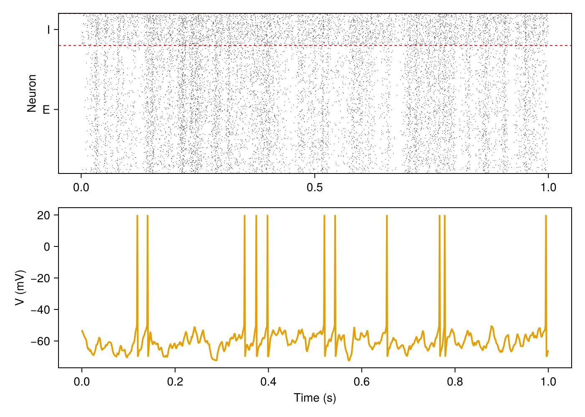

# Getting started

After this page you can build a network of excitatory and inhibitory neurons, drive it with
Poisson input, simulate it and plot its activity.

<!-- run: sequential -->

## Install

```
] add SpikingNeuralNetworks CairoMakie
```

`SpikingNeuralNetworks` loads the models (`SNNModels`), the plots (`SNNPlots`) and the analysis
tools (`SNNUtils`), and defines the alias `SNN`. `CairoMakie` renders the figures.

## A balanced E/I network

```julia
using SpikingNeuralNetworks
SNN.@load_units                      # ms, mV, nS, pF, Hz, ... in the current scope
using CairoMakie

synapse = SNN.SingleExpSynapse(τe = 5ms, τi = 5ms, E_e = 0mV, E_i = -80mV)
spike = SNN.PostSpike(τabs = 2ms)
E = SNN.IF(; N = 800, param = SNN.IFParameter(C = 200pF, gl = 10nS, Vt = -50mV, Vr = -70mV),
           synapse, spike, name = "E")
I = SNN.IF(; N = 200, param = SNN.IFParameter(C = 200pF, gl = 10nS, Vt = -53mV, Vr = -70mV),
           synapse, spike, name = "I")

EE = SNN.SpikingSynapse(E, E, :ge; conn = (p = 0.05, μ = 2nS))
EI = SNN.SpikingSynapse(E, I, :ge; conn = (p = 0.05, μ = 2nS))
IE = SNN.SpikingSynapse(I, E, :gi; conn = (p = 0.05, μ = 20nS))
II = SNN.SpikingSynapse(I, I, :gi; conn = (p = 0.05, μ = 20nS))

noise = SNN.PoissonLayer(rate = 20Hz, N = 100)
inE = SNN.Stimulus(noise, E, :ge; conn = (p = 0.1, μ = 4nS))
inI = SNN.Stimulus(noise, I, :ge; conn = (p = 0.1, μ = 4nS))

model = SNN.compose(; E, I, EE, EI, IE, II, inE, inI)
```

- A population (`SNN.IF`) is `N` neurons of one model. Its `param` sets the membrane,
  `synapse` how input becomes a current, `spike` the reset and refractory period.
- A connection (`SNN.SpikingSynapse(pre, post, target; conn)`) adds the weight of every synapse
  of a firing neuron to `target` of `post`: `:ge` is the excitatory, `:gi` the inhibitory
  conductance. `conn` gives the connection probability `p` and the mean weight `μ`.
- A stimulus (`SNN.Stimulus`) is external input; here 100 Poisson neurons at 20 Hz.
- `compose` collects everything into a model, a `NamedTuple` with `pop`, `syn`, `stim` and
  the clock `time`.

All numbers are in the unit system of the library (ms, mV, nS, pF, pA); writing the units
makes this explicit.

## Simulate and record

```julia
SNN.monitor!(model.pop, [:fire])          # all spikes of E and I
SNN.monitor!(E, [:v], sr = 1kHz)          # membrane potential, sampled at 1 kHz
SNN.sim!(model, 1s)
```

`monitor!` registers what to record before the run; `sim!` advances the model by one second
with the default step `dt = 0.125ms`. Calling `sim!` again continues from where it stopped.

## Analyse and plot

```julia
rates, r, names = SNN.firing_rate(model.pop; interval = 0:10ms:1s, pop_average = true)

fig = Figure(size = (700, 500))
SNN.raster!(Axis(fig[1, 1], ylabel = "Neuron"), model.pop)
SNN.vecplot!(Axis(fig[2, 1], ylabel = "V (mV)", xlabel = "Time (s)"), E, :v,
             neurons = 1, add_spikes = true)
save("getting_started.png", fig)
```



E fires at about 10 Hz and I at about 20 Hz, irregularly.

## Next steps

- [Populations](populations.md), [Connections](catalogue/connections.md) and [Stimuli](stimuli.md).
- [Running simulations](simulation.md): `sim!`, `train!`, time step, precision, threads.
- [Recordings](recordings.md) and [Visualization](visualization.md).
- [Plasticity](plasticity.md): STDP, short-term plasticity, `train!`.
- [Examples](examples.md): single neurons, noise, dendrites, FORCE learning.
- [Model catalogue](catalogue/index.md): every model with its equations.
