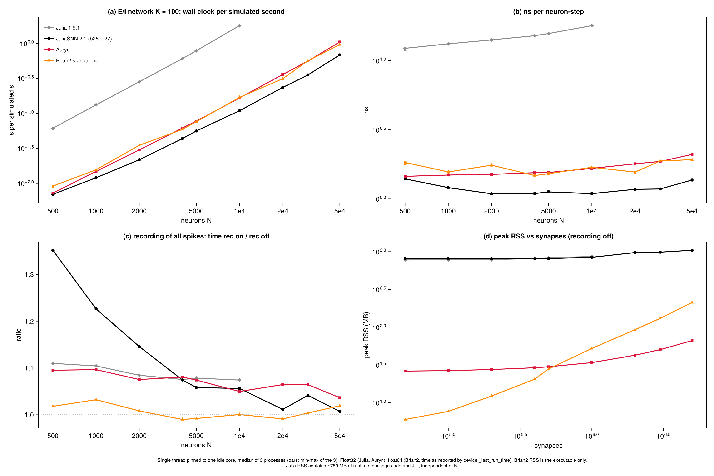
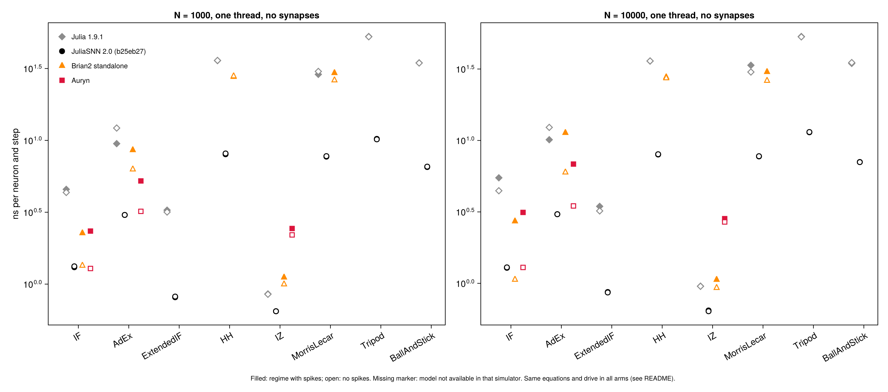
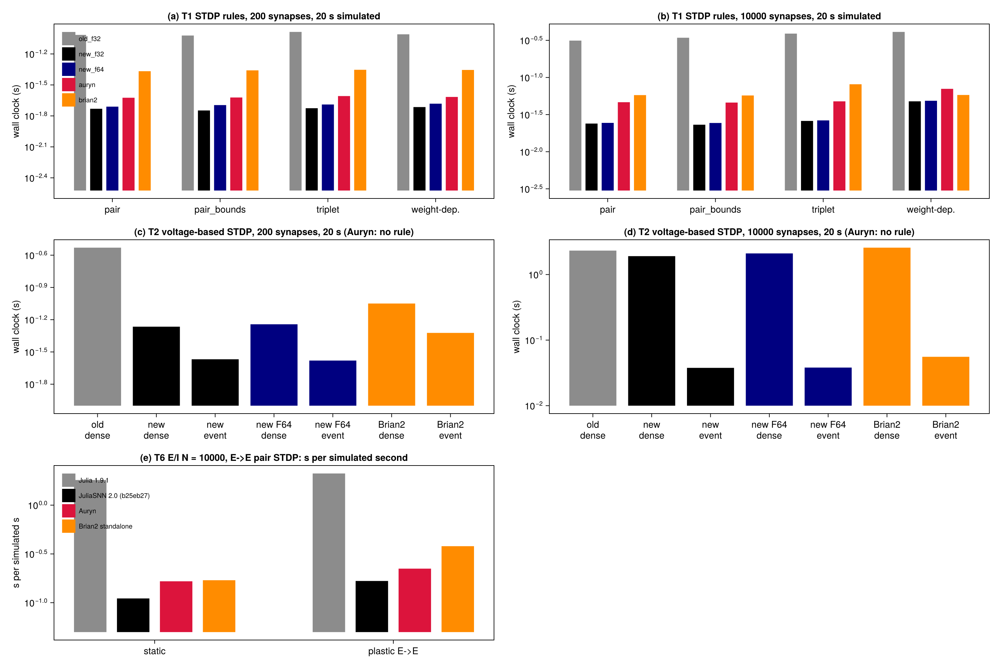
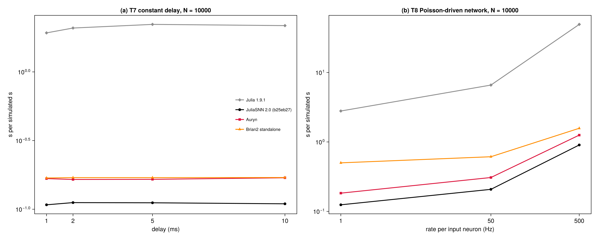

# Performance comparison

This page compares SpikingNeuralNetworks.jl v2 (SNNModels 2.0) with its predecessor v1
(SNNModels 1.9.1) and with two established simulators:
[Auryn](https://fzenke.net/auryn/) and [Brian2](https://briansimulator.org/) (C++ standalone mode).
All arms simulate the same models with the same parameters, connectivity and inputs.

## Method

- **Machine.** Intel Xeon w5-3425, Linux 6.8, Julia 1.12.6, Brian2 2.9.0 (`cpp_standalone`,
  g++ 13.3 with Brian2's default flags), Auryn 0.8.3 (`-O3 -march=native -ffast-math`).
- **One thread.** Every arm runs on one thread pinned to an idle core (`taskset`). Brian2 OpenMP,
  Auryn MPI and Julia threading are not part of these comparisons.
- **Precision.** Julia and Auryn use `Float32`, Brian2 uses `float64`. Julia `Float64` runs are
  reported where relevant.
- **Timing.** Each value is the median of 3 processes. Only the simulation is timed: compilation,
  Julia's first-call (JIT) cost and network construction are excluded. For Brian2 the time is
  `device._last_run_time` as Brian2 reports it.
- **Versions.** v2 was measured at SNNModels commit `b25eb27`; v1 is SNNModels 1.9.1.
- **Correctness.** Timings are only compared between runs that agree:
  - single LIF neuron: identical spike times across the three simulators;
  - STDP final weights: equal to within 1e-6 between v1, v2 and Brian2;
  - balanced network: matching rate and CV-ISI distributions at N = 4000.

The campaign's data, scripts and full tables are in the `JuliaSNN_publication` repository
(`validation/profilation_v1.10/perf/final_v2`).

## Balanced E/I network

A network of leaky integrate-and-fire neurons:

- 80 % excitatory neurons, K = 100 inputs per neuron;
- current-based synapses with a 5 ms time constant;
- 0.8 ms delays, dt = 0.1 ms, recording off.

The table gives the wall-clock time per simulated second.

| N | v1 (s) | v2 (s) | Auryn (s) | Brian2 (s) | v2 ns per neuron-step |
|---|---|---|---|---|---|
| 500 | 0.0614 | 0.00697 | 0.00728 | 0.00916 | 1.40 |
| 1 000 | 0.132 | 0.0121 | 0.0149 | 0.0157 | 1.21 |
| 2 000 | 0.283 | 0.0218 | 0.0301 | 0.0351 | 1.09 |
| 4 000 | 0.606 | 0.0437 | 0.0618 | 0.0590 | 1.09 |
| 10 000 | 1.79 | 0.109 | 0.166 | 0.169 | 1.09 |
| 20 000 | - | 0.235 | 0.359 | 0.313 | 1.17 |
| 50 000 | - | 0.684 | 1.05 | 0.961 | 1.37 |

- **v2 against v1:** v2 is 9 to 16 times faster than v1. v1 was measured only up to N = 10 000.
- **v2 against Auryn and Brian2:** v2 is 1.0 to 1.6 times faster than Auryn and Brian2 at every size.
- **Spike recording:** recording every spike costs v2 6 % at N = 5 000 and 1 % at N = 50 000.
- **Memory:** the synapse arrays take 8.3 bytes per synapse, close to Auryn's 8.5. Brian2 takes 42.
  - Julia's peak RSS has a fixed part of about 800 MB for the runtime, the package code and the JIT.
  - Auryn and Brian2 use 26 to 212 MB in total.

## Neuron models

The table gives the cost of integrating each neuron model, in ns per neuron per step. The setup is
N = 10 000 neurons with no synapses, driven into the spiking regime.

| model | v1 | v2 Float32 | v2 Float64 | Brian2 | Auryn |
|---|---|---|---|---|---|
| IF | 5.48 | 1.28 | 3.00 | 2.72 | 3.14 |
| AdEx | 10.1 | 3.05 | 5.19 | 11.3 | 6.83 |
| HH | 36.0 | 7.97 | 11.0 | 27.8 | - |
| Izhikevich | 0.96 | 0.65 | 1.30 | 1.06 | 2.84 |
| Morris-Lecar | 33.6 | 7.73 | 33.2 | 30.2 | - |
| Tripod | 53.4 | 11.4 | 32.7 | - | - |
| BallAndStick | 34.6 | 7.07 | 18.4 | - | - |

A dash means the model is not available in that simulator. The integration schemes of the
simulators differ, so the firing rates are similar but not identical: AdEx fires at 71 Hz in Julia
and at 81 Hz in Brian2 and Auryn.

## Synaptic plasticity

### STDP rules

The test is 200 or 10 000 Poisson inputs onto one neuron, with 20 s simulated. The table gives the
wall-clock time in seconds.

| synapses | rule | v1 | v2 | Auryn | Brian2 |
|---|---|---|---|---|---|
| 200 | pair | 0.0965 | 0.0186 | 0.0238 | 0.0430 |
| 200 | triplet | 0.103 | 0.0188 | 0.0247 | 0.0443 |
| 10 000 | pair | 0.314 | 0.0239 | 0.0464 | 0.0579 |
| 10 000 | triplet | 0.390 | 0.0260 | 0.0477 | 0.0810 |
| 10 000 | weight-dependent | 0.411 | 0.0477 | 0.0703 | 0.0581 |

STDP is event-driven in v2, as it is in Auryn and Brian2. Its cost therefore grows slowly with the
number of synapses.

### Voltage-based STDP (Clopath)

This uses the same setup as the STDP rules, with 20 s simulated. Auryn has no voltage-based STDP
rule. The Brian2 event-driven version is hand-written for this comparison.

| synapses | v1 dense | v2 dense | v2 event-driven | Brian2 dense | Brian2 event-driven |
|---|---|---|---|---|---|
| 200 | 0.295 | 0.0543 | 0.0270 | 0.0892 | 0.0476 |
| 10 000 | 2.32 | 1.91 | 0.0377 | 2.57 | 0.0557 |

- **Dense mode** (`vSTDPDenseParameter`) updates every synapse at every step, so its cost grows with
  the number of synapses.
- **Event-driven mode** (`vSTDPParameter`, the default in v2) brings the cost at 10 000 synapses
  down to about 1.6 times that of pair STDP, against about 80 times for dense mode.

### Plastic network

This is the balanced network with pair STDP on the E→E connections. The table gives the time per
simulated second for N = 10 000.

| | v1 | v2 | Auryn | Brian2 |
|---|---|---|---|---|
| static | 1.81 | 0.111 | 0.166 | 0.170 |
| plastic E→E | 2.11 | 0.167 | 0.223 | 0.380 |

All four simulators give the same rates (6.7 to 6.9 Hz) and the same final E→E weight
distributions.

## Delays and Poisson input

Both tests use the balanced network with N = 10 000. The tables give the time per simulated second.

**Synaptic delays.** In v2 the delays are stored in ring buffers, so the cost does not depend on
the delay length.

| delay | v1 | v2 | Auryn | Brian2 |
|---|---|---|---|---|
| 1 ms | 1.92 | 0.108 | 0.167 | 0.169 |
| 10 ms | 2.17 | 0.110 | 0.169 | 0.170 |

**Poisson input.** The network receives input from a Poisson population, and the table gives the
rate of each input neuron.

| input rate | v1 | v2 | Auryn | Brian2 |
|---|---|---|---|---|
| 1 Hz | 2.79 | 0.124 | 0.183 | 0.500 |
| 50 Hz | 6.59 | 0.208 | 0.307 | 0.612 |
| 500 Hz | 49.3 | 0.904 | 1.25 | 1.57 |

## Notes

- **Not measured:** threading, MPI and OpenMP, which are not included in these comparisons.
- **Precision:** `Float64` populations cost 1.4 to 4 times the `Float32` ones, depending on the
  model, and 2.3 times on the E/I network.
- **Per-call overhead:** after the measurement, SNNModels 2.0.1 removed a fixed cost of 12 to
  30 ns from each call of the single-step `train!`. This cost matters only for very small networks
  stepped one call at a time, such as the plasticity tests above, where it is a few percent of the
  time.
  - With 2.0.1, pair STDP at 10 000 synapses takes 0.020 s.
  - Event-driven voltage-based STDP at 10 000 synapses takes 0.036 s.
