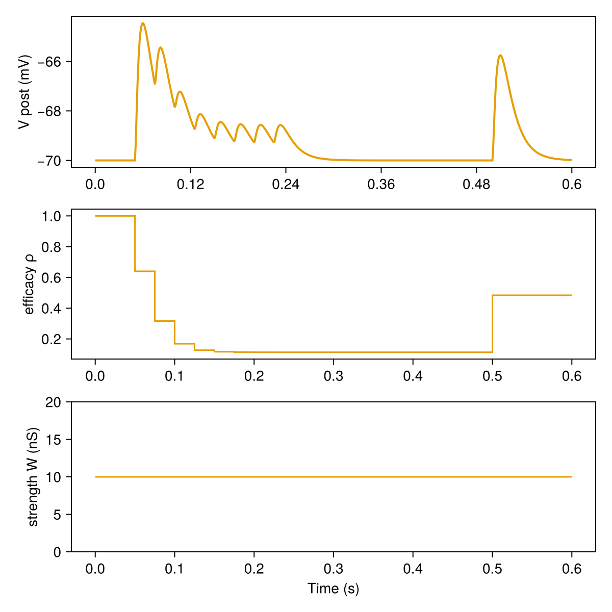
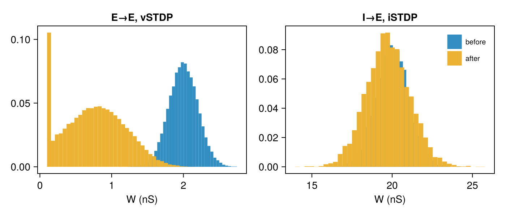
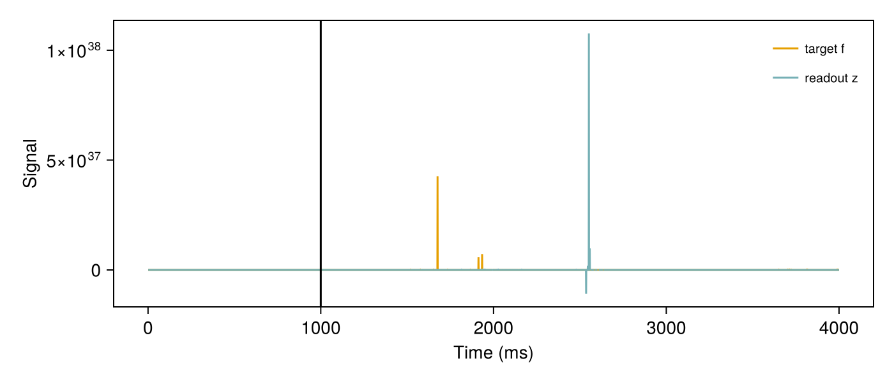

# Tutorial: plasticity

After this tutorial you can add short-term and long-term plasticity to a synapse, see which
quantity each one changes, read the weights, and switch rules. Details:
[Plasticity](../plasticity.md) and [Plasticity rules](../catalogue/plasticity_rules.md).

<!-- run: sequential -->

## Efficacy and strength

A spike of presynaptic neuron ``j`` adds ``W_{ij}\,\rho_{ij}`` to the target of neuron ``i``:

| | Short-term plasticity (STP) | Long-term plasticity (LTP) |
|:-|:-|:-|
| acts on | the efficacy ``\rho``, field `syn.ρ` | the strength ``W``, field `syn.W` |
| set with | `STPParam = SNN.MarkramSTPParameter()` | `LTPParam = SNN.STDPGerstner()`, `SNN.vSTDPParameter()`, `SNN.iSTDPRate()`, ... |
| lifetime | transient: recovers within hundreds of ms | persistent: stays until the rule changes it again |
| read with | `SNN.SNNModels.efficacy(syn)`; state `u`, `x` with `SNN.plasticity_value(syn, :STPVars, :u, t)` | `SNN.plasticity_value(syn, :W)` |

Without a short-term rule ``\rho = 1`` and `syn.ρ` is not stored; without a long-term rule `W`
never changes. Both run only under `train!`.

## Short-term plasticity: the efficacy changes, W does not

One presynaptic neuron fires 8 spikes at 40 Hz, then once more after a pause, onto one
postsynaptic neuron through a depressing synapse.

```julia
using SpikingNeuralNetworks
SNN.@load_units
using CairoMakie

pre = SNN.Identity(N = 1, name = "pre")
times = [collect(50ms:25ms:225ms); 500ms]
drive = SNN.SpikeTimeStimulusIdentity(pre, :g; param = SNN.SpikeTimeParameter(times, fill(1, length(times))))
post = SNN.IF(N = 1, name = "post")
post.v .= -70mV
syn = SNN.SpikingSynapse(pre, post, :ge; conn = fill(10nS, 1, 1),
                         STPParam = SNN.MarkramSTPParameter(U = 0.4, τD = 200ms, τF = 50ms))
model = SNN.compose(; pre, post, syn, drive, silent = true)

SNN.monitor!(syn, [:ρ, :W], sr = 1kHz)
SNN.monitor!(post, [:v], sr = 1kHz)
SNN.train!(model, 600ms)

ρ, r = SNN.record(syn, :ρ, range = true)
W = SNN.record(syn, :W)
fig = Figure(size = (600, 600))
SNN.vecplot!(Axis(fig[1, 1], ylabel = "V post (mV)"), post, :v)
stairs!(Axis(fig[2, 1], ylabel = "efficacy ρ"), r ./ 1000, ρ(1, r), step = :post)
lines!(Axis(fig[3, 1], ylabel = "strength W (nS)", xlabel = "Time (s)"), r ./ 1000, W(1, r))
save("stp.png", fig)
```



`ρ` holds the efficacy of the last spike: it drops along the train (resources are depleted) and
the spike after the pause is larger (they recovered). `W` stays at 10 nS throughout.

## Long-term plasticity: W changes and stays

The E/I network of [Getting started](../getting_started.md) with voltage-based STDP on E→E and
inhibitory STDP on I→E. No short-term rule is set, so the efficacy is 1 everywhere.

```julia
synapse = SNN.SingleExpSynapse(τe = 5ms, τi = 5ms, E_e = 0mV, E_i = -80mV)
spike = SNN.PostSpike(τabs = 2ms)
E = SNN.IF(; N = 800, param = SNN.IFParameter(C = 200pF, gl = 10nS, Vt = -50mV, Vr = -70mV),
           synapse, spike, name = "E")
I = SNN.IF(; N = 200, param = SNN.IFParameter(C = 200pF, gl = 10nS, Vt = -53mV, Vr = -70mV),
           synapse, spike, name = "I")
EE = SNN.SpikingSynapse(E, E, :ge; conn = (p = 0.05, μ = 2nS, σ = 0.2nS),
                        LTPParam = SNN.vSTDPParameter(A_LTD = 1.6e-2, A_LTP = 2.8e-2, Wmax = 4nS))
EI = SNN.SpikingSynapse(E, I, :ge; conn = (p = 0.05, μ = 2nS))
IE = SNN.SpikingSynapse(I, E, :gi; conn = (p = 0.05, μ = 20nS, σ = 1nS),
                        LTPParam = SNN.iSTDPRate(r = 5Hz, η = 0.2, Wmax = 40nS))
II = SNN.SpikingSynapse(I, I, :gi; conn = (p = 0.05, μ = 20nS))
noise = SNN.PoissonLayer(rate = 20Hz, N = 100)
inE = SNN.Stimulus(noise, E, :ge; conn = (p = 0.1, μ = 4nS))
inI = SNN.Stimulus(noise, I, :ge; conn = (p = 0.1, μ = 4nS))
net = SNN.compose(; E, I, EE, EI, IE, II, inE, inI, silent = true)

W_EE0 = copy(SNN.plasticity_value(EE, :W))
W_IE0 = copy(SNN.plasticity_value(IE, :W))
SNN.train!(net, 2s)
W_EE = SNN.plasticity_value(EE, :W)       # vSTDP updates W lazily: read it through the accessor
W_IE = SNN.plasticity_value(IE, :W)
all(==(1), SNN.SNNModels.efficacy(EE))    # true: no transient factor

fig = Figure(size = (700, 300))
for (k, (name, w0, w1)) in enumerate([("E→E, vSTDP", W_EE0, W_EE), ("I→E, iSTDP", W_IE0, W_IE)])
    ax = Axis(fig[1, k], title = name, xlabel = "W (nS)")
    hist!(ax, w0, bins = 40, normalization = :probability, label = "before")
    hist!(ax, w1, bins = 40, normalization = :probability, label = "after")
    k == 2 && axislegend(ax)
end
save("ltp.png", fig)
```



The weights keep their new values after training: run `sim!(net, 1s)` and `plasticity_value(EE, :W)`
is unchanged.

## Switching rules

`change_plasticity` returns a new model in which one synapse has other rules; `NoLTP()` and
`NoSTP()` switch a part off. Here E→E moves from vSTDP to pair STDP, then is frozen.

```julia
net = SNN.change_plasticity(net, :EE; LTP = SNN.STDPGerstner(A_pre = 1e-3, A_post = -1e-3, Wmax = 4nS))
SNN.train!(net, 500ms)                               # pair STDP on E→E
net = SNN.change_plasticity(net, :EE; LTP = SNN.NoLTP())
W_frozen = copy(net.syn.EE.W)
SNN.train!(net, 500ms)                               # iSTDP still learns, E→E does not
net.syn.EE.W == W_frozen                             # true
```

For a single synapse, `SNN.with_plasticity(syn; LTP, STP)` and `SNN.without_plasticity(syn)`
return the new synapse; put it in the model with `compose` (see [Plasticity](../plasticity.md#Switching-rules)).

## Learning a signal: FORCE

200 rate units connected by an `FLSynapse` whose readout `z` learns a target signal `f` by
recursive least squares ([Sussillo and Abbott, 2009](https://www.sciencedirect.com/science/article/pii/S0896627309005479)):
it learns under `train!` and is tested under `sim!`.

```julia
S = SNN.Rate(; N = 200)
SS = SNN.FLSynapse(S, S; μ = 1.5, p = 1.0)
force = SNN.compose(; S, SS, silent = true)
SNN.monitor!(SS, [:f, :z], sr = 1000Hz)

A = 1.3 / 1.5
fr = 1 / 60ms
f(t) = A * sin(π * fr * t) + A / 2 * sin(2π * fr * t) + A / 6 * sin(3π * fr * t) + A / 3 * sin(4π * fr * t)
for t = 0:0.125ms:1000ms        # training
    SS.f = f(t)
    SNN.train!(force, 0.125ms)
end
for t = 1000ms:0.125ms:1500ms   # test
    SS.f = f(t)
    SNN.sim!(force, 0.125ms)
end

fig = Figure(size = (700, 300))
ax = Axis(fig[1, 1], xlabel = "Time (ms)", ylabel = "Signal")
lines!(ax, SNN.getrecord(SS, :f), label = "target f")
lines!(ax, SNN.getrecord(SS, :z), label = "readout z")
vlines!(ax, [1000], color = :black)
axislegend(ax)
save("force.png", fig)
```



## More scripts

Runnable scripts in the `examples/tutorials` folder of the package:

- [`plasticity/STP_demo.jl`](https://github.com/JuliaSNN/SpikingNeuralNetworks.jl/blob/main/examples/tutorials/plasticity/STP_demo.jl): short-term plasticity: ρ, u, x
- [`networks/AdEx_STP.jl`](https://github.com/JuliaSNN/SpikingNeuralNetworks.jl/blob/main/examples/tutorials/networks/AdEx_STP.jl): network with short-term depression
- [`networks/STP_het.jl`](https://github.com/JuliaSNN/SpikingNeuralNetworks.jl/blob/main/examples/tutorials/networks/STP_het.jl): heterogeneous short-term plasticity from experimental fits
- [`stdp_demo.jl`](https://github.com/JuliaSNN/SpikingNeuralNetworks.jl/blob/main/examples/tutorials/stdp_demo.jl): pair STDP: weight change against spike-time difference
- [`STDP_kernel.jl`](https://github.com/JuliaSNN/SpikingNeuralNetworks.jl/blob/main/examples/tutorials/STDP_kernel.jl): kernels of all long-term rules
- [`plasticity/AdEx_plasticity.jl`](https://github.com/JuliaSNN/SpikingNeuralNetworks.jl/blob/main/examples/tutorials/plasticity/AdEx_plasticity.jl): vSTDP network with synaptic normalisation
- [`networks/synaptic_turnover.jl`](https://github.com/JuliaSNN/SpikingNeuralNetworks.jl/blob/main/examples/tutorials/networks/synaptic_turnover.jl): random synaptic turnover
- [`plasticity/AdEx_turnover.jl`](https://github.com/JuliaSNN/SpikingNeuralNetworks.jl/blob/main/examples/tutorials/plasticity/AdEx_turnover.jl): activity-dependent turnover in space
- [`rate_models/rate_net.jl`](https://github.com/JuliaSNN/SpikingNeuralNetworks.jl/blob/main/examples/tutorials/rate_models/rate_net.jl): rate network
- [`rate_models/Oja_rule.jl`](https://github.com/JuliaSNN/SpikingNeuralNetworks.jl/blob/main/examples/tutorials/rate_models/Oja_rule.jl): Oja rule in a rate network
- [`rate_models/pinning_net.jl`](https://github.com/JuliaSNN/SpikingNeuralNetworks.jl/blob/main/examples/tutorials/rate_models/pinning_net.jl): PINning
- [`rate_models/ppc.jl`](https://github.com/JuliaSNN/SpikingNeuralNetworks.jl/blob/main/examples/tutorials/rate_models/ppc.jl): rate network with a trained readout
