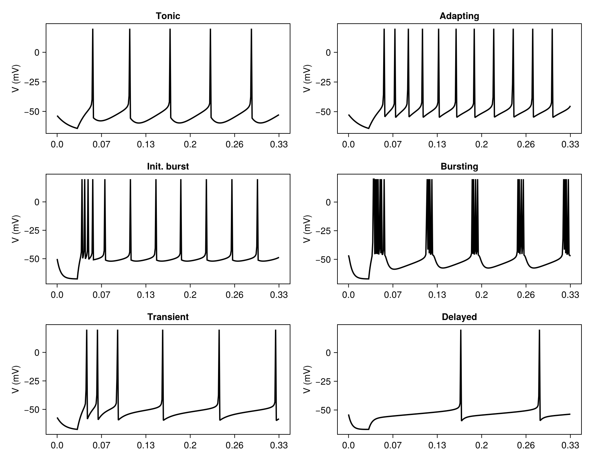
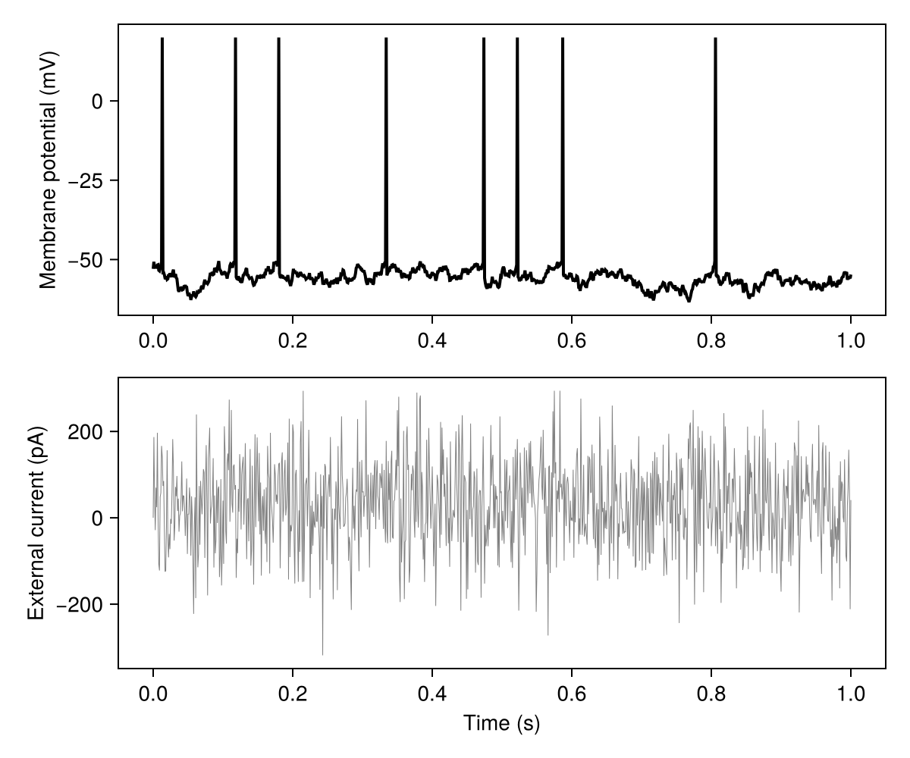
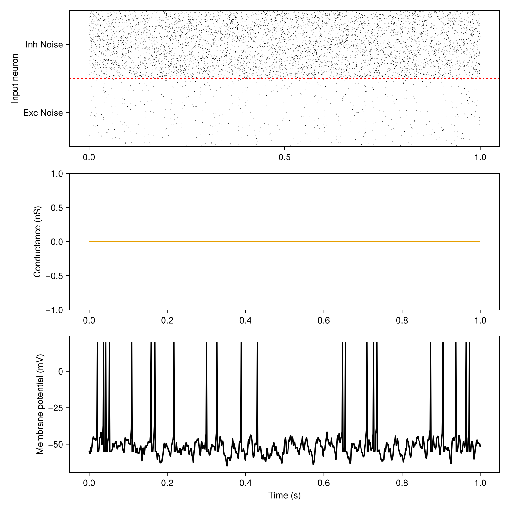
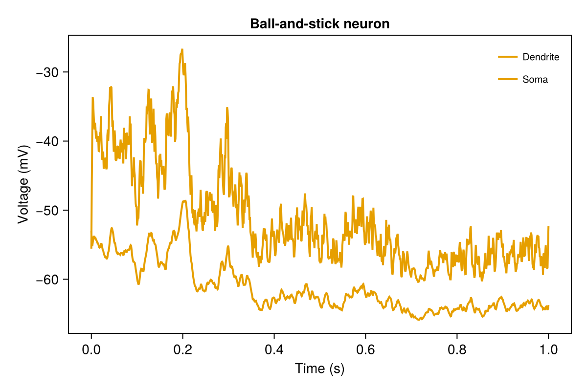

# Tutorial: populations

After this tutorial you can build single neurons and populations of several models, drive them with
currents and spikes, record their variables and plot them. Details: [Populations](../populations.md),
[Stimuli](../stimuli.md), [Recordings](../recordings.md), [Model catalogue](../catalogue/index.md).

<!-- run: sequential -->

## One neuron, one current step: AdEx firing patterns

The AdEx neuron ([Brette and Gerstner, 2005](https://pubmed.ncbi.nlm.nih.gov/16014787/)) gives
different firing patterns for different membrane and adaptation parameters. Each panel is one
neuron that receives a weak current for 30 ms, then a current step; `E.I` is the external current.

```julia
using SpikingNeuralNetworks
SNN.@load_units
using CairoMakie
using Distributions

# (pattern, τm (ms), a (nS), τw (ms), b (pA), Vr (mV), I (pA))
patterns = [
    ("Tonic", 20, 0.0, 30.0, 60.0, -55.0, 65),
    ("Adapting", 20, 0.0, 100.0, 5.0, -55.0, 65),
    ("Init. burst", 5.0, 0.5, 100.0, 7.0, -51.0, 65),
    ("Bursting", 5.0, -0.5, 100.0, 7.0, -46.0, 65),
    ("Transient", 10, 1.0, 100, 10.0, -60.0, 65),
    ("Delayed", 5.0, -1.0, 100.0, 10.0, -60.0, 25),
]

fig = Figure(size = (900, 700))
for (n, (name, τm, a, τw, b, Vr, I)) in enumerate(patterns)
    param = SNN.AdExParameter(
        R = 0.5GΩ,
        Vt = -50mV,
        ΔT = 2mV,
        El = -70mV,
        τm = τm * ms,
        Vr = Vr * mV,
        a = a * nS,
        b = b * pA,
        τw = τw * ms,
    )
    E = SNN.AdEx(; N = 1, param)
    SNN.monitor!(E, [:v, :fire, :w], sr = 8kHz)
    model = SNN.compose(; E, silent = true)

    E.I .= 5pA                      # weak current for 30 ms
    SNN.sim!(; model, duration = 30ms)
    E.I .= I * pA                   # current step
    SNN.sim!(; model, duration = 300ms)

    ax = Axis(fig[(n - 1) ÷ 2 + 1, (n - 1) % 2 + 1], title = name, ylabel = "V (mV)")
    SNN.vecplot!(ax, E, :v, add_spikes = true, color = :black)
end
save("adex_patterns.png", fig)
```



## A noisy current

`CurrentNoise` sets the target variable to `I_base` plus a fresh Gaussian sample at every step;
`Stimulus(param, population, :I)` attaches it to the current `I`. `Population(; param, synapse,
spike, N)` builds the population that matches `param`, here an `IF`.

```julia
if_neuron = (
    param = SNN.IFParameter(R = 0.5GΩ, Vt = -50mV, El = -70mV, τm = 20ms, Vr = -55mV),
    spike = SNN.PostSpike(),
    synapse = SNN.SingleExpSynapse(),
)
E = SNN.Population(; N = 1, if_neuron...)
SNN.monitor!(E, [:v, :fire, :I], sr = 2kHz)

# white-noise input current
current_param = SNN.CurrentNoise(E.N; I_base = 30pA, I_dist = Normal(0pA, 100pA))
current_stim = SNN.Stimulus(current_param, E, :I)
model = SNN.compose(; E, I = current_stim, silent = true)
SNN.sim!(; model, duration = 1000ms)

fig = Figure(size = (600, 500))
ax1 = Axis(fig[1, 1], ylabel = "Membrane potential (mV)")
SNN.vecplot!(ax1, E, :v, add_spikes = true, color = :black)
ax2 = Axis(fig[2, 1], ylabel = "External current (pA)", xlabel = "Time (s)")
SNN.vecplot!(ax2, E, :I, color = :gray, lw = 0.5)
save("noise_current.png", fig)
```



## Spikes as input

Two layers of 1000 Poisson neurons, excitatory onto `:glu` and inhibitory onto `:gaba`, drive one
AdEx neuron into the high-conductance state. The layers are recorded like populations.

```julia
neuron_parameter = (
    param = SNN.AdExParameter(R = 0.5GΩ, Vt = -50mV, ΔT = 2mV, El = -70mV, τm = 20ms, Vr = -55mV),
    synapse = SNN.DoubleExpSynapse(),
    spike = SNN.PostSpike(τabs = 5ms),
)
E = SNN.Population(; neuron_parameter..., N = 1)

poisson_exc = SNN.PoissonLayer(rate = 1Hz, N = 1000)
poisson_inh = SNN.PoissonLayer(rate = 10Hz, N = 1000)
conn = (p = 1, μ = 5nS)
stim_exc = SNN.Stimulus(poisson_exc, E, :glu; conn, name = "Exc Noise")
stim_inh = SNN.Stimulus(poisson_inh, E, :gaba; conn, name = "Inh Noise")

model = SNN.compose(; E, stim_exc, stim_inh, silent = true)
SNN.monitor!(E, [:v, :fire], sr = 2kHz)
SNN.monitor!(E, [:glu, :gaba], sr = 2kHz, variables = :receptors) # receptor conductances
SNN.monitor!(model.stim, [:fire])
SNN.sim!(; model, duration = 1000ms)

fig = Figure(size = (800, 800))
ax1 = Axis(fig[1, 1], ylabel = "Input neuron")
SNNPlots.raster!(ax1, model.stim)
ax2 = Axis(fig[2, 1], ylabel = "Conductance (nS)")
SNN.vecplot!(ax2, E, :glu, variables = :receptors, label = "glu")
SNN.vecplot!(ax2, E, :gaba, variables = :receptors, label = "gaba")
ax3 = Axis(fig[3, 1], ylabel = "Membrane potential (mV)", xlabel = "Time (s)")
SNN.vecplot!(ax3, E, :v, add_spikes = true, color = :black)
save("poisson_input.png", fig)
```



## A neuron with a dendrite

`BallAndStick` couples an AdEx soma to a passive dendrite with NMDA receptors; inputs choose the
compartment with an extra argument, `:s` (soma) or `:d` (dendrite).

```julia
adex = SNN.AdExParameter(C = 281pF, gl = 40nS, Vr = -55.6mV, El = -70.6mV, ΔT = 2mV,
                         Vt = -50.4mV, a = 4nS, b = 80.5pA, τw = 144ms)
E = SNN.BallAndStick(N = 1, adex = adex,
                     param = SNN.BallAndStickParameter(ds = [(160um, 160um)]))

stim_exc = SNN.Stimulus(SNN.PoissonLayer(rate = 10Hz, N = 1000), E, :glu, :d;
                        conn = (p = 1, μ = 1nS), name = "noiseE")
stim_inh = SNN.Stimulus(SNN.PoissonLayer(rate = 3Hz, N = 1000), E, :gaba, :d;
                        conn = (p = 1, μ = 4nS), name = "noiseI")

model = SNN.compose(; E, stim_exc, stim_inh, silent = true)
SNN.monitor!(E, [:v_s, :v_d, :fire], sr = 1kHz)
SNN.sim!(; model, duration = 1s)

fig = Figure()
ax = Axis(fig[1, 1], xlabel = "Time (s)", ylabel = "Voltage (mV)", title = "Ball-and-stick neuron")
SNN.vecplot!(ax, E, :v_d, label = "Dendrite")
SNN.vecplot!(ax, E, :v_s, add_spikes = true, label = "Soma")
axislegend(ax)
save("ballandstick.png", fig)
```



## More scripts

Runnable scripts in the `examples/tutorials` folder of the package:

- [`neurons/IF_neuron.jl`](https://github.com/JuliaSNN/SpikingNeuralNetworks.jl/blob/main/examples/tutorials/neurons/IF_neuron.jl): IF neuron under Poisson input
- [`neurons/IF_noise_input.jl`](https://github.com/JuliaSNN/SpikingNeuralNetworks.jl/blob/main/examples/tutorials/neurons/IF_noise_input.jl): IF neuron under a noisy current
- [`neurons/AdEx_neuron.jl`](https://github.com/JuliaSNN/SpikingNeuralNetworks.jl/blob/main/examples/tutorials/neurons/AdEx_neuron.jl): AdEx firing patterns, V and w
- [`neurons/AdEx_threshold.jl`](https://github.com/JuliaSNN/SpikingNeuralNetworks.jl/blob/main/examples/tutorials/neurons/AdEx_threshold.jl): AdEx with adaptive threshold
- [`neurons/AdEx_balanced_stimuli.jl`](https://github.com/JuliaSNN/SpikingNeuralNetworks.jl/blob/main/examples/tutorials/neurons/AdEx_balanced_stimuli.jl): AdEx under balanced Poisson input
- [`neurons/AdEx_multireceptors.jl`](https://github.com/JuliaSNN/SpikingNeuralNetworks.jl/blob/main/examples/tutorials/neurons/AdEx_multireceptors.jl): AdEx with AMPA, NMDA, GABA receptors
- [`neurons/Izikievich_neuron.jl`](https://github.com/JuliaSNN/SpikingNeuralNetworks.jl/blob/main/examples/tutorials/neurons/Izikievich_neuron.jl): Izhikevich firing patterns
- [`neurons/HH_neuron.jl`](https://github.com/JuliaSNN/SpikingNeuralNetworks.jl/blob/main/examples/tutorials/neurons/HH_neuron.jl): Hodgkin-Huxley f-I curve
- [`neurons/MorrisLecar_neuron.jl`](https://github.com/JuliaSNN/SpikingNeuralNetworks.jl/blob/main/examples/tutorials/neurons/MorrisLecar_neuron.jl): Morris-Lecar phase plane
- [`neurons/BallAndStick_neuron.jl`](https://github.com/JuliaSNN/SpikingNeuralNetworks.jl/blob/main/examples/tutorials/neurons/BallAndStick_neuron.jl): ball-and-stick neuron, receptor conductances
- [`neurons/Tripod_neuron.jl`](https://github.com/JuliaSNN/SpikingNeuralNetworks.jl/blob/main/examples/tutorials/neurons/Tripod_neuron.jl): Tripod neuron, receptor conductances
- [`neurons/Tripod_multireceptors.jl`](https://github.com/JuliaSNN/SpikingNeuralNetworks.jl/blob/main/examples/tutorials/neurons/Tripod_multireceptors.jl): Tripod with several receptors
- [`neurons/tripod2.jl`](https://github.com/JuliaSNN/SpikingNeuralNetworks.jl/blob/main/examples/tutorials/neurons/tripod2.jl): Tripod under dendritic Poisson input
- [`neurons/HetRec_layer.jl`](https://github.com/JuliaSNN/SpikingNeuralNetworks.jl/blob/main/examples/tutorials/neurons/HetRec_layer.jl): HetRec layer
- [`neurons/PoissonPop.jl`](https://github.com/JuliaSNN/SpikingNeuralNetworks.jl/blob/main/examples/tutorials/neurons/PoissonPop.jl): Poisson population: rates and ISI CV
- [`timed_stim.jl`](https://github.com/JuliaSNN/SpikingNeuralNetworks.jl/blob/main/examples/tutorials/timed_stim.jl): spike-time stimulus
- [`networks/IF_net.jl`](https://github.com/JuliaSNN/SpikingNeuralNetworks.jl/blob/main/examples/tutorials/networks/IF_net.jl): IF network
- [`networks/HH_net.jl`](https://github.com/JuliaSNN/SpikingNeuralNetworks.jl/blob/main/examples/tutorials/networks/HH_net.jl): Hodgkin-Huxley network
- [`networks/Izikievich_net.jl`](https://github.com/JuliaSNN/SpikingNeuralNetworks.jl/blob/main/examples/tutorials/networks/Izikievich_net.jl): Izhikevich network
- [`networks/AdEx_net.jl`](https://github.com/JuliaSNN/SpikingNeuralNetworks.jl/blob/main/examples/tutorials/networks/AdEx_net.jl): AdEx network with heterogeneous parameters and delays
- [`networks/AdExVarStimuli.jl`](https://github.com/JuliaSNN/SpikingNeuralNetworks.jl/blob/main/examples/tutorials/networks/AdExVarStimuli.jl): network driven by a time-varying Poisson rate
- [`networks/COBA.jl`](https://github.com/JuliaSNN/SpikingNeuralNetworks.jl/blob/main/examples/tutorials/networks/COBA.jl): conductance-based benchmark network
- [`networks/CUBA.jl`](https://github.com/JuliaSNN/SpikingNeuralNetworks.jl/blob/main/examples/tutorials/networks/CUBA.jl): current-based benchmark network
- [`networks/afferent_response.jl`](https://github.com/JuliaSNN/SpikingNeuralNetworks.jl/blob/main/examples/tutorials/networks/afferent_response.jl): network rate against afferent rate
- [`networks/weak_strong_afferents.jl`](https://github.com/JuliaSNN/SpikingNeuralNetworks.jl/blob/main/examples/tutorials/networks/weak_strong_afferents.jl): synchrony against afferent rate
- [`networks/ParadoxicalEffect.jl`](https://github.com/JuliaSNN/SpikingNeuralNetworks.jl/blob/main/examples/tutorials/networks/ParadoxicalEffect.jl): paradoxical response of an inhibition-stabilised network
- [`networks/passive_vs_active_dendrites.jl`](https://github.com/JuliaSNN/SpikingNeuralNetworks.jl/blob/main/examples/tutorials/networks/passive_vs_active_dendrites.jl): networks of passive and NMDA-active dendrites
- [`networks/out_degree.jl`](https://github.com/JuliaSNN/SpikingNeuralNetworks.jl/blob/main/examples/tutorials/networks/out_degree.jl): out-degree of the connectivity rules
- [`analysis/recordings.jl`](https://github.com/JuliaSNN/SpikingNeuralNetworks.jl/blob/main/examples/tutorials/analysis/recordings.jl): every way to read a recording
