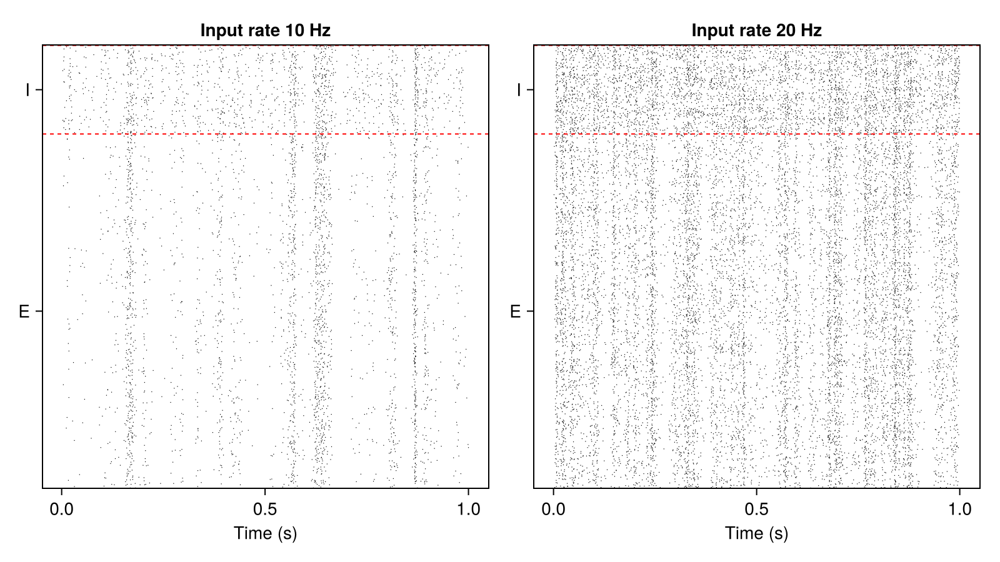

# Tutorial: simulations

After this tutorial you can build a network from a configuration, run it, save it to disk, load it
back, continue or rerun it, and sweep a parameter. Details: [Running simulations](../simulation.md).

<!-- run: sequential -->

## A network from a configuration

```julia
using SpikingNeuralNetworks
SNN.@load_units
using CairoMakie, Random

config = (
    N = (E = 800, I = 200),
    exc = SNN.IFParameter(C = 200pF, gl = 10nS, Vt = -50mV, Vr = -70mV),
    inh = SNN.IFParameter(C = 200pF, gl = 10nS, Vt = -53mV, Vr = -70mV),
    synapse = SNN.SingleExpSynapse(τe = 5ms, τi = 5ms, E_e = 0mV, E_i = -80mV),
    spike = SNN.PostSpike(τabs = 2ms),
    conn = (EE = (p = 0.05, μ = 2nS), EI = (p = 0.05, μ = 2nS),
            IE = (p = 0.05, μ = 20nS), II = (p = 0.05, μ = 20nS)),
    input = (N = 100, rate = 20Hz, p = 0.1, μ = 4nS),
)

function network(config)
    (; N, exc, inh, synapse, spike, conn, input) = config
    E = SNN.IF(; N = N.E, param = exc, synapse, spike, name = "E")
    I = SNN.IF(; N = N.I, param = inh, synapse, spike, name = "I")
    EE = SNN.SpikingSynapse(E, E, :ge; conn = conn.EE)
    EI = SNN.SpikingSynapse(E, I, :ge; conn = conn.EI)
    IE = SNN.SpikingSynapse(I, E, :gi; conn = conn.IE)
    II = SNN.SpikingSynapse(I, I, :gi; conn = conn.II)
    noise = SNN.PoissonLayer(rate = input.rate, N = input.N)
    inE = SNN.Stimulus(noise, E, :ge; conn = (p = input.p, μ = input.μ))
    inI = SNN.Stimulus(noise, I, :ge; conn = (p = input.p, μ = input.μ))
    return SNN.compose(; E, I, EE, EI, IE, II, inE, inI, silent = true)
end

model = network(config)
SNN.sim!(model, 500ms)                      # let the network settle
```

A function of a configuration `NamedTuple` makes a network easy to rebuild, save with its
parameters, and vary.

## Save, load and continue

```julia
dir = mktempdir()
SNN.save_model(; model, path = dir, name = "ei", info = (rate = 20,), config)
loaded = SNN.load_model(dir, "ei", (rate = 20,))
copy1 = loaded.model
SNN.get_time(copy1.time)                    # 500.0: the clock is saved with the model
loaded.config.input.rate                    # 0.02 (20 Hz), the configuration is saved too
SNN.sim!(copy1, 500ms)                      # continue from 500 ms
SNN.get_time(copy1.time)                    # 1000.0
```

`save_model` writes the model (weights, state, clock) and, optionally, its `config` to a folder
named after `name` and `info`; `load_model` returns them. Recordings are not saved with the model.

## Rerun from the same state

Load the saved model twice and run both copies with the same random seed: they are identical.

```julia
a = SNN.load_model(dir, "ei", (rate = 20,)).model
b = SNN.load_model(dir, "ei", (rate = 20,)).model
for m in (a, b)
    SNN.monitor!(m.pop, [:fire])
    Random.seed!(42)
    SNN.sim!(m, 500ms)
end
SNN.spiketimes(a.pop.E) == SNN.spiketimes(b.pop.E)    # true
```

The same pattern runs one saved, settled network under several conditions.

## Sweep a parameter

`SNN.@update` returns a modified copy of a configuration:

```julia
fig = Figure(size = (800, 450))
for (n, rate) in enumerate([10, 20])
    cfg = SNN.@update config begin
        input.rate = rate * Hz
    end
    m = network(cfg)
    SNN.monitor!(m.pop, [:fire])
    SNN.sim!(m, 1s)
    ax = Axis(fig[1, n], title = "Input rate $rate Hz", xlabel = "Time (s)")
    SNN.raster!(ax, m.pop)
end
save("sweep.png", fig)
```



## Precision and threads

```julia
E64 = SNN.IF(N = 100, VFT = Vector{Float64})            # a Float64 population
SNN.float_type(E64)                                    # Float64
SNN.sim!(model, 100ms; neurons_per_thread = 512)       # threaded if Julia has threads
```

See [Precision](../simulation.md#Precision) and [Threads](../simulation.md#Threads).

## More scripts

Runnable scripts in the `examples/tutorials` folder of the package:

- [`perturbations/EI_network_perturbation.jl`](https://github.com/JuliaSNN/SpikingNeuralNetworks.jl/blob/main/examples/tutorials/perturbations/EI_network_perturbation.jl): perturbing a running E/I network
- [`extensions/neuron_model.jl`](https://github.com/JuliaSNN/SpikingNeuralNetworks.jl/blob/main/examples/tutorials/extensions/neuron_model.jl): a new neuron model (see [Model extensions](../models_ext.md))
- [`extensions/stimulus_model.jl`](https://github.com/JuliaSNN/SpikingNeuralNetworks.jl/blob/main/examples/tutorials/extensions/stimulus_model.jl): a new stimulus model
- [`extensions/doubleExpCurrent.jl`](https://github.com/JuliaSNN/SpikingNeuralNetworks.jl/blob/main/examples/tutorials/extensions/doubleExpCurrent.jl): a new synapse model
